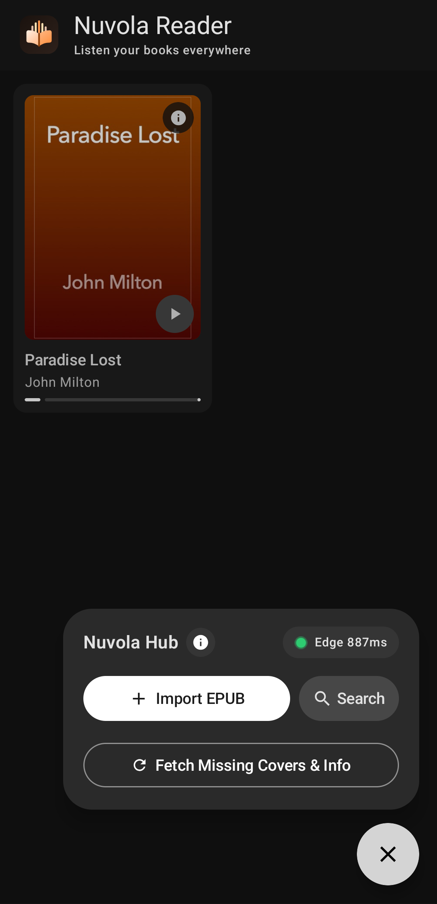
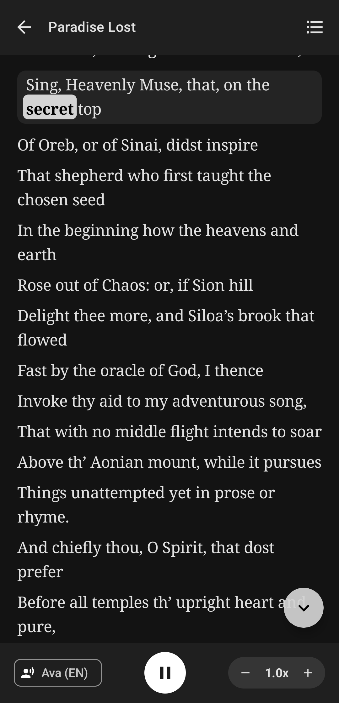

<p align="center">
  
</p>

<h1 align="center">Nuvola Reader</h1>

<p align="center">
  <strong>Read and listen to EPUB books on Android with neural Edge-TTS narration and real-time word highlighting.</strong>
</p>

<p align="center">
  
  
  
  <a href="LICENSE"></a>
</p>

<p align="center">
  <a href="#screenshots">Screenshots</a> ·
  <a href="#architecture">Architecture</a> ·
  <a href="#pre-built-apk-and-building-from-source">Install / Build</a> ·
  <a href="#android-permissions">Permissions</a> ·
  <a href="#credits-and-license">License</a>
</p>

> [!NOTE]
> **Unverified Developer Warning (Google Play Protect):** Because this is an independent open-source project and the APK is signed automatically in CI without a paid Google Play Developer account, Android's Play Protect will show an *"Unrecognized app developer"* prompt during installation. Simply tap **"More details" -> "Install anyway"** to proceed. You can verify the exact build logs and workflow steps at any time in the [Actions](../../actions) tab.

## Let's address the elephant in the room right away...

Yes, AI was involved in this project.

I'm a computer science student exploring different programming languages and wanted to dive deeper into Rust. Over the last few months I also got really into audiobooks, so I started putting this project together. AI helped me a lot to speed up the work and get through the trickier parts, like the EPUB parser and Android-specific stuff such as cache management and the media player, as well as debugging and testing along the way. It also helped me structure this repo in a more professional way (because I'm still pretty new to GitHub).

That said, I kept AI on a tight leash to avoid mindless vibecoding, focusing on simplicity, a clean UI, and only the features that actually matter (and because I will be using the app too, and I love the stock Material UI).

# Screenshots

<p align="center">
  
  &nbsp;&nbsp;
  
  &nbsp;&nbsp;
  
</p>

## Architecture

The project is split into two main components:
- **`rust-core` (Native Rust library)**: Handles EPUB 2/3 parsing, sentence and word segmentation, Edge-TTS WebSocket synthesis, SHA-256 audio caching, and online metadata lookup. Compiled into `libnuvola_core.so` and exposed via JNI.
- **`android-app` (Kotlin / Jetpack Compose)**: Manages the Material 3 UI, local library state, and background audio playback through AndroidX Media3 (`ExoPlayer`).

```text
edge-tts-app/
├── rust-core/
│   └── src/
│       ├── epub/    # EPUB parser and online metadata lookup
│       ├── chunker/ # Sentence and word segmentation
│       ├── tts/     # Rust implementation of edge-tts and local cache
│       └── ffi/     # JNI bindings for Android
└── android-app/
    └── app/src/main/java/com/nuvola/reader/
        ├── bridge/  # Kotlin JNI wrapper
        ├── data/    # Local book storage and saved reading state
        ├── player/  # ExoPlayer controller and background media service
        └── ui/      # Compose screens and ViewModel
```

### 1. Speech Synthesis & Direct Network Model

Audio narration relies on Microsoft Edge's Read Aloud service. Rather than embedding a Python environment on Android, the communication protocol from the Python [`edge-tts`](https://github.com/rany2/edge-tts) package was ported to Rust.

The app does not use any intermediary backend or proxy server. When playback starts, your device connects directly to Microsoft's endpoints using its own Wi-Fi or mobile data IP address. Because requests originate from each user's personal connection rather than a shared server IP, traffic is naturally distributed and avoids centralized rate limits.

Currently, the in-app voice selector includes curated neural voices for **English** (US and UK) and **Italian** (since I'm Italian), though the underlying `edge-tts` engine supports the full Microsoft voice catalog.

### 2. Media Player & Word-Level Synchronization

Playback is powered by AndroidX Media3 (`ExoPlayer`) paired with a background `MediaSessionService`, so narration keeps running with the screen off and can be controlled from the lock screen, notification shade, or Bluetooth headphones.

While Microsoft Edge streams the audio, it also sends `WordBoundary` timestamps over the WebSocket. The Rust engine aligns those timestamps with the tokenized paragraph text, allowing the UI to highlight each word in real time as it is spoken. Tapping any word in the book immediately resolves its sentence chunk and starts reading from that exact point (*click-to-read*). To avoid awkward pauses between sentences or paragraphs, the engine pre-buffers the next chunk in the background while the current one is playing.

### 3. Local Storage & Audio Caching

All application data is stored inside the app's private directory on the device:
- **TTS Audio Cache (`cacheDir/nuvola_tts_cache`)**: Synthesized MP3 segments and word timings are indexed by the SHA-256 hash of the selected voice, pitch, and text. Re-reading a passage plays directly from local storage without new network calls. The cache is automatically trimmed at startup whenever it exceeds 150 MB.
- **Library Storage (`filesDir`)**: Imported EPUB files, cover images, and reading bookmarks are persisted separately so clearing the audio cache never affects your books or reading progress.

### 4. Privacy & Book Metadata Lookup

Nuvola Reader contains no analytics, telemetry, or tracking, and it does not require user accounts or API keys.

Aside from Microsoft Edge's speech endpoints (`speech.platform.bing.com`), the app only connects to public book catalogs when an imported EPUB is missing a cover image or bibliographic details. In those cases it queries the Google Books API, falls back to the Apple Books Search API for high-resolution covers, and finally checks the Open Library API if needed. Once a book's metadata and cover are saved on the device, those services are not contacted again unless manually refreshed.

## Pre-built APK and Building from Source

If you just want to try the app without installing Rust or Android Studio, you can download the latest pre-built APK directly from the **Releases** section of this repository.

The APK is built, signed, and published automatically by **GitHub Actions** ([`.github/workflows/ci.yml`](.github/workflows/ci.yml)). Whenever a new version tag (`v*`) is pushed, GitHub spins up a clean Ubuntu runner, runs the `rust-core` test suite, cross-compiles `libnuvola_core.so` for Android (`arm64-v8a`, `armeabi-v7a`, and `x86_64`) using `cargo-ndk`, packages and signs the optimized release APK with Gradle (`assembleRelease`), and attaches it directly to the GitHub Release. This also guarantees that the downloadable APK is built transparently from the exact source code in this repo (and can be tracked directly with tools like [Obtainium](https://github.com/ImranR98/Obtainium)).

### Building Locally

Building the project on your own machine requires Rust 1.75 or newer, `cargo-ndk`, JDK 17 or 21, and the Android SDK and NDK.

Using `make` from the repository root, you can compile both the native Rust engine and the Android APK in one step:

```bash
make apk-debug
make apk-release
make install
make test
```

Alternatively, you can run the build steps manually. First, compile the native Rust library for Android from the `rust-core` directory:

```bash
cd rust-core
cargo ndk \
  -t arm64-v8a \
  -t armeabi-v7a \
  -t x86_64 \
  -o ../android-app/app/src/main/jniLibs \
  build --release
```

Then assemble the debug APK from the `android-app` directory:

```bash
cd android-app
./gradlew assembleDebug
```

The compiled package will be placed in `android-app/app/build/outputs/apk/debug/app-debug.apk`.

To run the Rust unit and integration tests:

```bash
cd rust-core
cargo test
```

### What's Excluded (`.gitignore`)

To keep the repository clean and avoid committing machine-specific paths or binary bloat, [`.gitignore`](.gitignore) excludes:
- **Compiled binaries and build caches (`target/`, `build/`, `.gradle/`, `jniLibs/**/*.so`, `*.apk`)**: Native `.so` libraries and APKs are generated during the build step (locally or via GitHub Actions) rather than tracked in Git.
- **Local environment and signing keys (`local.properties`, `*.jks`, `*.keystore`)**: Machine-specific Android SDK/NDK paths and release keystores stay strictly local.
- **Generated test media (`rust-core/tests/*.mp3`, `*.srt`, `nuvola_tts_cache/`)**: Temporary audio and subtitle outputs are ignored, while keeping only the public-domain `paradise_lost.epub` fixture required for integration tests.
- **Agent configs, `graphify`, and local scratch folders (`.agents/`, `graphify-out/`, `.ignore/`)**: You'll also notice a few entries in `.gitignore` that aren't strictly part of the app (which I'll clean up later). Specifically, `.agents/` and `graphify-out/` are ignored for now: I wanted to test `graphify` on my own and experiment with agent configurations, but since I'm still figuring out how useful they actually are for the repo, I'm leaving them out until I decide whether to integrate them properly or remove them.

# Android Permissions

The application requests only the permissions strictly necessary for network synthesis and background playback:

| Permission | Purpose |
| :--- | :--- |
| `INTERNET` & `ACCESS_NETWORK_STATE` | Connect to Microsoft Edge speech endpoints and public book metadata catalogs. |
| `FOREGROUND_SERVICE` & `FOREGROUND_SERVICE_MEDIA_PLAYBACK` | Keep narration active when the screen is off or the app is in the background. |
| `POST_NOTIFICATIONS` | Display media player controls in the notification shade and lock screen on Android 13+. |
| `WAKE_LOCK` | Prevent the processor and network socket from sleeping while an audio chunk is streaming. |

The app does not request broad access to device storage. EPUB files are imported through the standard Android system file picker, which grants access only to the individual file chosen by the user.

# Credits and License

Special thanks to [rany2](https://github.com/rany2), author of the Python [`edge-tts`](https://github.com/rany2/edge-tts) library, whose work provided the foundation for the Rust speech synthesis engine.

Because `edge-tts` is released under a GNU license (LGPL-3.0) and its synthesis protocol was ported directly into `rust-core`, this project is also licensed under the [GNU General Public License v3.0 (GPL-3.0)](LICENSE).
